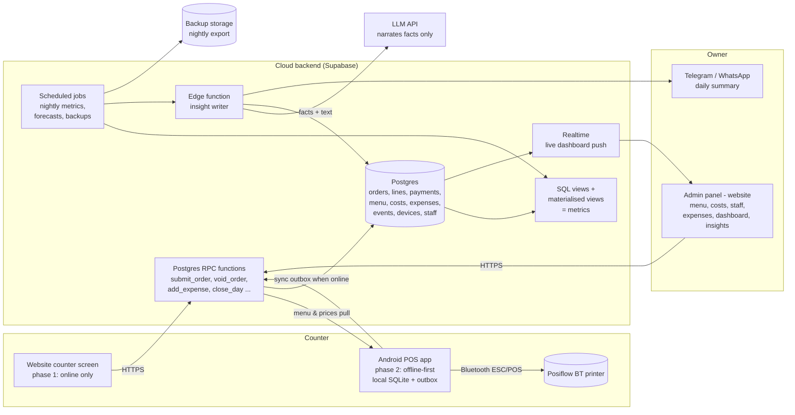

# Phase 2: Architecture

**Status:** Proposal. Everything here is **HYPOTHESIS** until Shrey approves it (see `decisions.md`, D-3xx).
**Date:** 22 Oct 2026
**Inputs:** `00-vision.md`, `01-research.md` (incl. revisions 1–2), `decisions.md`.

---

## 0. The short version

- **One backend, two apps.** A Postgres backend in the cloud (Supabase) is the single source of truth. The **website** (counter screen + admin panel) gets built first and talks to it directly. The **Android app** comes later, keeps its own copy on the phone/tablet so billing never stops, and syncs to the same backend.
- **You manage everything from the admin panel:** menu, variants, add-ons, combos, **prices and costs**, staff, expenses, and the dashboards and insights.
- **We build on dummy data from day one.** A seed script creates a fake outlet with the placeholder menu and about 90 days of realistic fake orders, expenses and voids, so every screen and insight can be built and tested before you've typed in anything real. The fake outlet is kept fully separate from your real one.
- **Insights come in two layers.** First, plain SQL computes the numbers. Then an AI writes sentences using **only** those numbers, and a checker rejects anything containing a number that wasn't computed.
- **Cost:** about ₹0/month while testing. About ₹2,000–4,000/month once live, if we pay for backups and commercial hosting (§9).

---

## 1. Architecture diagram

---

## 2. Data flows (end to end)

### 2.1 Taking an order, website phase (online)
1. Staff logs in with a **4-digit PIN** on the counter screen. The device is already registered (it has a device code like `T1`).
2. Staff taps items, variants and add-ons. The total is computed **on the client** from the cached menu.
3. Staff taps **Cash** or **UPI** (split allowed). For cash, an optional "received ₹500" field shows the change.
4. The client generates the **order UUID** and the next **bill number** (`T1-000124`) and calls `submit_order(payload)`.
5. The backend validates it (prices match the menu version, the staff member is active, the day is open) and stores the order, lines, payments and an `order_created` event **in one transaction**. If a retry arrives with the same UUID, nothing happens (idempotent).
6. The receipt shows on screen (no printing in this phase, D-208). The live dashboard updates within about a second through Realtime.

### 2.2 Taking an order, Android phase (offline-first)
1–3. Same as above, but the menu comes from the **local SQLite copy**.
4. The order is written to local SQLite **and** to an **outbox** table in one local transaction. That's the moment the bill counts as saved.
5. The print job goes to the **print queue**, then out to the printer over Bluetooth (SPP). If the print fails, the job stays queued with a Retry button. Billing carries on regardless.
6. A **sync worker** sends outbox rows to the same `submit_order` RPC whenever there's internet. It retries with backoff, and it's safe to resend because of the UUID.
7. **Menu, prices and staff flow down** from the backend to the device, pulled on app start, every few minutes, and on a push signal.

**Why there are almost no sync conflicts:** only the device creates bills, and only the admin edits the menu. Bills are **append-only** (a void is a new event, not an edit), so two writers never touch the same row.

### 2.3 Changing the menu or a cost (admin panel)
1. Shrey edits an item's price or cost in the admin panel.
2. The backend writes a **new effective-dated price/cost row**. The old row is kept, never overwritten.
3. The menu version goes up, and devices pull the new version.
4. Old bills keep the price they were sold at, and the margin for past days uses the cost in force at the time.

### 2.4 Money out (expenses and cash movements)
- **Expense:** category (ingredients, packaging, gas, rent, salary, other), amount, Cash or UPI, note, optional photo of the receipt, who entered it.
- **Cash out of the drawer** (e.g. "₹2,000 to the supplier") and **cash in** (opening float, change top-up) are logged as cash movements.
- The live dashboard shows **money in − money out**, split by cash and UPI, and the **cash that should be in the drawer** right now.

### 2.5 Day open and day close
- **Open:** count the opening float and enter it.
- **Close:** the app shows expected cash, staff enter the counted cash, and the **variance** is stored. Optional leftovers step (D-217). Then a **Z-report** (that day's totals, closed and locked) is generated.
- Close triggers the **daily summary** (§6).

### 2.6 Voids and discounts
- A void needs a reason and, if the staff member's role requires it, the **owner's PIN**. It's stored as a `void` event pointing at the order, and the original order is untouched.
- Discounts work the same way: amount or %, a reason, who gave it, and who approved it.

### 2.7 Insights (nightly, plus on day close)
1. **Scheduled SQL** refreshes the metrics views: sales by hour, AOV, item mix, margin, voids by staff, cash variance, expense trends, and the prep forecast.
2. A **facts builder** picks the noteworthy facts: changes against the norm, top and bottom items, anomalies. Each fact is a JSON row with an ID and exact numbers.
3. The **insight writer** sends *only those facts* to the LLM and asks for 3–5 plain-language bullets, each tied to fact IDs.
4. The **number checker** confirms every number in the text appears in the facts. If anything fails, it falls back to a template sentence.
5. The result is stored in `insights` and shown in the admin panel and the daily message.

---

## 3. Layer-by-layer choices

### 3.1 Website (counter screen + admin panel)

| Option | Pros | Cons | Effort (solo) | Fit |
|---|---|---|---|---|
| **Next.js (React, TypeScript)** | Huge ecosystem, good chart libraries, easy hosting, shares TypeScript with an RN app later | Bigger framework than needed | Low–Med | ✅ |
| SvelteKit | Lighter, fast | Smaller ecosystem; no code sharing with React Native | Low–Med | OK |
| Plain React (Vite) SPA | Simplest | Build your own routing and auth patterns | Low | OK |

**Recommendation: Next.js + TypeScript**, one app with two areas: `/counter` (big-button, tablet-first) and `/admin`. Charts with Recharts or ECharts.

### 3.2 Android app (phase 2) 💸 expensive to reverse

| Option | Bluetooth Classic printing | Offline DB | Reuse from website | "Native" feel | Solo effort | Risk |
|---|---|---|---|---|---|---|
| **Kotlin + Jetpack Compose** | ✅ Best: direct Android Bluetooth API | Room (SQLite) ✅ | ❌ none, everything rewritten | ✅ | High | Low tech risk, high effort |
| **React Native (Expo dev build) + TypeScript** | ✅ via a native module (existing library, or a small module of our own) | SQLite (expo-sqlite / op-sqlite) ✅ | ✅ shares types, pricing, validation, bill numbering, API client | ✅ native UI | Medium | Medium: library upkeep |
| Flutter | ✅ good printer packages | sqflite / drift ✅ | ❌ (Dart) | ✅ | Medium–High | Printer package churn (Phase 1 §2.4) |
| Capacitor (wrap the website) | ✅ via plugin | SQLite plugin | ✅✅ max reuse | ⚠️ web view, not truly native | Low | Fragile plugin, not "native POS" |

**Recommendation: React Native (Expo, dev build) + a shared TypeScript package** with the website. It's genuinely native UI, it reuses the business logic written for the website, and we own the small Bluetooth printing module so we aren't stuck if a library is abandoned. **Fallback:** if Bluetooth printing on the Posiflow proves unreliable in the Android milestone 1, we write the printing part as a small Kotlin module inside the same app. That's a limited, contained change.

### 3.3 Backend

| Option | Pros | Cons | Cost at your scale | Fit |
|---|---|---|---|---|
| **Supabase** (managed Postgres + auth + realtime + scheduled jobs + edge functions) | Real SQL for analytics, realtime for the live dashboard, row-level security, little server code | Vendor platform (though it's plain Postgres underneath, so easy to leave); free tier has no backups and pauses projects after inactivity ⚠️ | Free for testing; Pro about $25/month ⚠️ | ✅ |
| Firebase (Firestore) | Great offline SDKs | NoSQL is a poor fit for sales analytics (no joins or GROUP BY); costs grow per read | Low–Med | ❌ for analytics |
| Custom Node/FastAPI + Postgres | Full control | You run servers, auth, backups and realtime yourself | $10–30/month VPS + time | OK later |

**Recommendation: Supabase.** Business rules live in **Postgres functions** (`submit_order`, `void_order`, `close_day`, ...), so the website and the Android app can't disagree about the rules. That directly fixes "inconsistent data".

### 3.4 Offline storage and sync (Android phase)

| Option | How it works | Pros | Cons |
|---|---|---|---|
| **Own outbox + idempotent RPC** | Local SQLite; new events go to an outbox; a worker pushes them; menu is pulled down | Simple, no extra vendor; fits append-only bills perfectly | We write the sync code (about a few hundred lines) |
| PowerSync | Managed Postgres ↔ SQLite sync, has RN SDK, works with Supabase | Handles sync edge cases for us | Another paid service ⚠️; overkill for one-way bills |
| WatermelonDB | Local DB with a sync protocol | Mature in RN | Needs custom pull/push endpoints anyway |
| ElectricSQL | Postgres sync | | Mainly read-path sync now ⚠️; not a fit for writes |

**Recommendation: own outbox + idempotent RPC.** Bills flow device → cloud, the menu flows cloud → device, and nothing is edited in both places.

**Bill numbers offline:** each device is registered with a code (`T1`, `T2`) and keeps its own counter, giving `T1-000124`. There are no clashes between devices and no server needed. A financial-year prefix can be added later if GST comes back (D-105).

### 3.5 Data model approach (full tables in Phase 3)

Principles:
- **`outlet_id` and UUIDs on every row** (multi-outlet ready, D-112).
- **Append-only financial records:** orders, lines and payments are never updated. Voids, refunds and discounts are separate rows or events.
- **Effective-dated prices and costs**, so history is never rewritten.
- **An event log** (`events`) records every action: who, what, when, which device. It's the audit trail, and it's the raw data for leakage insights.

Core table groups:

| Group | Tables |
|---|---|
| Setup | `outlets`, `devices`, `staff` (role, PIN hash), `settings` |
| Menu | `categories`, `items`, `variants`, `modifier_groups`, `modifiers`, `combos`, `combo_items`, `prices` (effective-dated), `costs` (effective-dated), `menu_versions` |
| Sales | `orders` (uuid, bill_no, device, staff, channel, external_order_id, created_at), `order_lines` (item, variant, qty, unit_price, unit_cost_snapshot, line_total), `order_line_modifiers`, `payments` (method cash/upi, amount), `order_adjustments` (void, discount, refund + reason + approver) |
| Money out | `expenses` (category, amount, method, note, photo), `cash_movements` (in/out, reason) |
| Day | `day_sessions` (opened_at, opening_float, closed_at, expected_cash, counted_cash, variance), `leftovers` (optional) , `stock_outs` (item sold out at time) |
| Ops | `events`, `print_jobs` (Android), `app_errors` |
| Insights | `metric_*` materialised views, `forecasts`, `insight_facts`, `insights` |

### 3.6 Analytics

| Option | Fit at ~300 bills/day |
|---|---|
| **Postgres views + materialised views, refreshed by scheduled jobs** | ✅ About 100k order rows a year is tiny for Postgres. No second database needed |
| DuckDB / separate warehouse | Overkill now. Revisit only for multi-outlet SaaS |

Dashboards are built in the admin panel. Live tiles (today's sales, in vs out, drawer cash) come from Realtime plus small queries. Trends come from the materialised views.

**Prep forecast, V1 method (simple and explainable):** for each item × weekday × 30-minute slot, take a weighted average of the last 4–6 matching weeks. Bump it up where the item sold out early (D-218), and round up to batch size. A smarter model (weather, festivals) is V2.

### 3.7 Insights: stopping the AI from inventing numbers

1. **Numbers only come from SQL.** The facts builder outputs JSON like `{id: "F12", metric: "drink_attach_rate", value: 0.12, period: "last_7d", baseline: 0.15}`.
2. **The AI only gets facts**, with the instruction to cite fact IDs (`[F12]`) and use no other numbers.
3. **Checker:** pull every number out of the AI's text and confirm each matches a fact value (allowing for formatting like 12% = 0.12). If any don't match, or a fact ID is missing, **reject** the text and use a **template sentence** instead.
4. **The AI never sees raw orders,** customer phone numbers or staff PINs.
5. **Model:** a small, cheap model is enough (e.g. Claude Haiku-class). There are a handful of calls per day, so the cost is a few rupees a day ⚠️ (confirm current pricing).

Until the AI layer is ready, the daily summary uses **templates only**, so it's useful from day one.

### 3.8 How insights reach you

| Channel | V1? | Notes |
|---|---|---|
| Admin dashboard (live + trends + insights page) | ✅ V1 | |
| Daily summary on **Telegram** | ✅ V1 | Free bot API, quick to build |
| Daily summary on **WhatsApp** | V2 | WhatsApp Business Cloud API: per-message charges and template approval ⚠️ |
| End-of-day Z-report (screen; printed on Android) | ✅ V1 | |

(Q17, WhatsApp vs Telegram, is still open. Telegram is the proposed default.)

### 3.9 Auth, roles, security

- **Owner:** email + OTP / password through Supabase Auth, with full admin.
- **Staff:** a **PIN** on the counter device (hashed), with no email needed. Roles: **owner**, **cashier**, and optionally **manager** later.
- **Permissions:** a cashier can bill and add expenses up to a limit. Voids, discounts above X, and editing the menu or costs need the owner (or the owner's PIN at the counter).
- **Devices** are registered by the owner once, each with a device token.
- **Row-level security** limits data to the right `outlet_id`. Clients never hold secret service keys.
- **Database rules** block UPDATE/DELETE on financial tables, so bills can't be edited even with a bug in the app.

### 3.10 Backups

- Supabase Pro has daily backups ⚠️ (retention depends on the plan).
- **Plus our own nightly export** (CSV/Parquet) to cheap object storage, kept for years. That means you own a copy whatever happens.
- Android phase: the local DB can export to a file manually too.

### 3.11 Observability

- **Sentry** (free tier) for website and Android crash reporting ⚠️.
- **`print_jobs`** records every print attempt, its result and the error code. Synced, so the admin panel can show "3 print failures today".
- **`app_errors`** logs failed RPC calls and sync backlog size. The admin panel shows "Android device T1 has 12 unsynced bills".

---

## 4. Dummy data and the demo outlet

Yes, we build on dummy data rather than waiting for the real menu.

- **A separate demo outlet** (`outlet = DEMO`) with the placeholder menu from `menu.md`, made-up costs, 2 fake staff, and 1–2 fake devices.
- **A seed script** that generates about **90 days of realistic orders**: evening peak 7–9pm, weekends about +30%, rainy-day bumps, combos, some sold-outs, about 2% voids (one "suspicious" staff member with more), cash variances, and expenses by category.
- **Every dashboard and insight is built and tested against the demo outlet,** so you can see the product working before going live.
- **Going live:** create your real outlet, enter your menu and costs in the admin panel, and the demo data never mixes with it. The demo can be hidden or deleted.

---

## 5. Build order (detail goes in Phase 3)

1. **Backend + demo data:** schema, RPC functions, seed script.
2. **Admin panel:** menu, variants, add-ons, combos, prices and costs, staff, devices.
3. **Counter screen (web):** order in ≤5 taps, Cash/UPI, on-screen receipt, voids and discounts.
4. **Money:** expenses, cash movements, day open and close.
5. **Dashboards:** live money in vs out, sales, items, margin, leakage.
6. **Daily summary on Telegram** (templates), **then the AI layer**.
7. **Android app:** milestone 1 is printing on the Posiflow end to end, then the counter screen, offline outbox and sync.

---

## 6. Hosting and cost

| Item | Testing | Live (recommended) | Notes |
|---|---|---|---|
| Supabase | Free | Pro ≈ $25/month ⚠️ | Free tier has no automatic backups and pauses after a week of no use ⚠️ |
| Web hosting (Vercel / Cloudflare Pages) | Free | Vercel Pro ≈ $20/month ⚠️, **or** Cloudflare Pages free ⚠️ | Vercel's free Hobby plan is for non-commercial use ⚠️ |
| Backup storage | Free | ~₹0–100 | Tiny data |
| Sentry | Free | Free | |
| Telegram | Free | Free | |
| AI | ~₹0 | A few rupees/day ⚠️ | |
| **Total** | **≈ ₹0** | **≈ ₹2,000–4,000/month** (cheapest: Supabase Pro + Cloudflare ≈ ₹2,100) | Correction to Phase 1, which estimated under ₹1,000. That was too low if we pay for proper backups |
| Android app | – | Play Console one-time $25 ⚠️, or sideload the APK for free | |

---

## 7. Risks and mitigations

| # | Risk | Impact | Mitigation |
|---|---|---|---|
| R-1 | GST deferred, but you may need it | Non-compliant bills | Data model keeps room for a tax mode and FY numbering. Confirm registration status before go-live |
| R-2 | Posiflow printing only tested in the Android phase | Rework late | 10-minute RawBT check now. Printing is Android milestone 1. Kotlin printing-module fallback |
| R-3 | Website is online-only | A test day stops if the internet drops | Only for testing. Keep a paper backup. Android brings offline |
| R-4 | React Native Bluetooth library abandoned | Printing breaks on updates | Own the small printing module. Kotlin fallback |
| R-5 | Sync bugs lose or duplicate bills | Wrong numbers | UUID idempotency, outbox never deleted until the server confirms, "unsynced count" on dashboard |
| R-6 | AI states a wrong number | Bad decisions | Facts-only input, number checker, template fallback |
| R-7 | Demo data leaks into real reports | Wrong insights | Separate outlet, demo badge in the UI, RLS by outlet |
| R-8 | Supabase free tier pauses or has no backups | Data loss in testing | Daily use plus our own nightly export. Pro when live |
| R-9 | Staff share PINs | Leakage insights blur | Short auto-lock, PIN per person, owner reviews voids |
| R-10 | Building too much before real use | Wasted effort | Ship the counter + money dashboard first, use it, then add insights based on what the data shows |

---

## 8. Expensive to reverse (decide carefully)

1. React Native vs Kotlin for Android (§3.2)
2. Supabase/Postgres as the backend (low lock-in because it's plain Postgres, but still the base for everything)
3. Append-only financial records and effective-dated prices and costs
4. Per-device bill numbering
5. Outbox sync instead of a sync vendor

---

## Open questions for Shrey

1. **Android framework:** OK with **React Native** (native app, shares code with the website), or do you specifically want **Kotlin** (most "native", slower to build, no shared code)?
2. **Live hosting budget:** is about ₹2,000–4,000/month fine once live, or should we aim for the cheapest setup (≈ ₹2,100) or even free with our own backups only?
3. **Daily summary:** Telegram (free, V1) OK, with WhatsApp later?
4. **Expense categories:** are ingredients, packaging, gas, rent, salary and other right? Anything to add, such as electricity or maintenance?
5. **Who can void and discount?** Owner only, or cashier up to a limit (e.g. ₹50 discount)?
6. **Domain:** do you want the website on a subdomain you own (e.g. `pos.yourdomain.in`), or is a free hosting URL fine for testing?
7. **Item cost:** will you enter rough costs in the admin panel later (needed for margin insights)?
